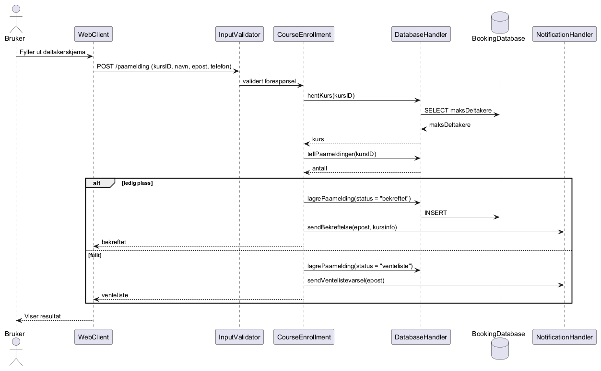

# Husflidslag kursportal

Studentprosjekt i emnet Software Engineering og testing ved Høgskolen i Østfold.
Gruppe 8: Amra Bajramovic, Simen Larsen, Dimitri Memlika, Kamal Sheikh, Henrik Wabakken.

## Om prosjektet

Ny nettside og kursportal for Østfold Husflidslag. Dagens løsning gjør det vanskelig for
medlemmene å finne og melde seg på kurs, og vanskelig for de frivillige i lokallagene å
legge ut innhold. Målet er en felles mal for de åtte lokallagene i fylket, med enklere
påmelding og et publiseringsverktøy som kan brukes uten teknisk hjelp.

Kunde: Østfold Husflidslag, ved Silja Holhjem.

## Innhold

    docs/
      diagrams/        PlantUML-kilder for modellene
      images/          Genererte diagrammer

## Modeller

| Diagram | Fil | Hva det viser |
|---|---|---|
| Komponentdiagram | `docs/diagrams/komponenter.puml` | Overordnede komponenter og hvordan de henger sammen |
| Klassediagram | `docs/diagrams/klasser.puml` | Data systemet håndterer |
| Sekvensdiagram | `docs/diagrams/paamelding.puml` | Flyten når en bruker melder seg på et kurs |
| Flytdiagram | `docs/diagrams/brukerflyt.puml` | Brukerens vei fra nettsiden til bekreftet påmelding |

### Sekvensdiagram: påmelding til kurs



Diagrammet viser begge utfallene av en påmelding: bekreftet plass hvis kurset har ledig
kapasitet, og venteliste hvis det er fullt.

## Slik genererer du diagrammene

Diagrammene skrives i PlantUML og kan vises på tre måter:

- Lim inn koden i nettleseren på plantuml.com
- Installer PlantUML-utvidelsen i VS Code og bruk forhåndsvisning
- Kjør lokalt med Java og `plantuml.jar` (lastes ned fra plantuml.com/download):

```
java -jar plantuml.jar -charset UTF-8 -tpng docs/diagrams/*.puml -o ../images
```

`-charset UTF-8` er nødvendig for at æ, ø og å skal komme riktig ut. Bildene i
`docs/images/` er generert, ikke håndlaget — kjør kommandoen på nytt og commit resultatet
hver gang en `.puml`-fil endres, ellers viser README et utdatert diagram.

## Avgrensninger

Modellene dekker kjernefunksjonaliteten rundt kurs og påmelding. Følgende er bevisst
holdt utenfor i denne omgang:

- Betalingsløsning. Leverandør er ikke valgt ennå.
- Verifisering av medlemskap mot Norges Husflidslag. Vi vet ikke om det finnes et API.
- Utleie av bunader.

## Status

Modellering pågår. Diagrammene oppdateres etter hvert som forståelsen av systemet endrer
seg, og tidligere versjoner beholdes i historikken.
